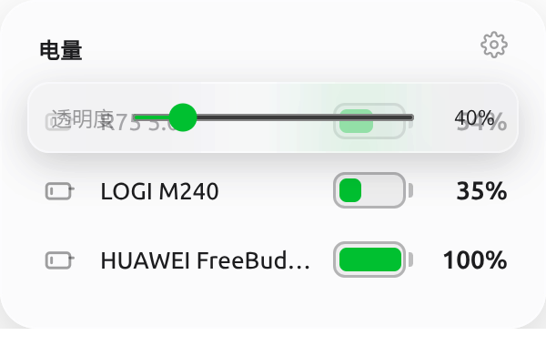

# PowerShow

轻量的桌面悬浮电量卡片，在桌面上以 AirBattery 风格的磨砂卡片实时显示本机蓝牙外设（键盘 / 鼠标 / 耳机 / 手柄）的剩余电量。



## 特性

- **磨砂悬浮卡片**：无边框、置顶、不进任务栏、不抢焦点，可任意拖动，位置自动记忆
- **iOS 风格电池胶囊**：横置电池图形 + 圆头填充，电量 <35% 变黄、<15% 变红
- **自动深浅双主题**：跟随系统 `prefers-color-scheme` 切换
- **背景透明度调节**：卡片内置设置面板，只调背景、文字与电量显示保持清晰
- **立即刷新**：标题栏刷新按钮手动拉取，默认每 60 秒自动刷新
- **系统托盘**：刷新 / 显示隐藏 / 退出

## 支持平台

| 平台 | 电量来源 | 状态 |
|---|---|---|
| Linux | `upower`（bluetoothd → UPower 转发的蓝牙外设电量） | ✅ 已验证 |
| Windows | `Win32_Battery`（蓝牙外设虚拟电池），降级 PnP `BatteryReportValue` | ✅ 实现 |

> 前提：蓝牙外设本身支持电量上报（蓝牙 HID over GATT 的 Battery Service）。部分老设备或使用 USB 接收器的设备不上报电量。

## 运行

```bash
npm install
npm start
```

要求 Node.js ≥ 18。

Linux Wayland 下如遇窗口异常，可用：

```bash
ELECTRON_OZONE_PLATFORM_HINT=wayland npm start
```

## 项目结构

```
main.js                 # 窗口（无边框/透明/置顶）、托盘、IPC、位置与设置持久化
preload.js              # contextBridge 安全桥接
renderer/
  index.html            # 卡片结构
  style.css             # 磨砂卡片、电池胶囊、深浅双主题
  renderer.js           # 列表渲染、设置面板、刷新交互
collectors/
  linux.js              # upower --dump 解析蓝牙外设电量
  windows.js            # PowerShell（Win32_Battery / PnP）采集
```

## 设置持久化

位置、背景透明度保存在 Electron `userData` 目录下的 `state.json`：

- Linux: `~/.config/battery-card/state.json`
- Windows: `%APPDATA%/battery-card/state.json`

## License

MIT
